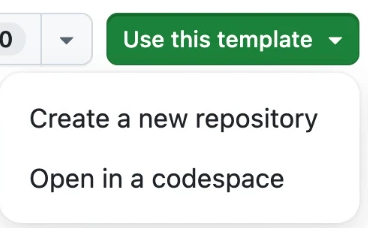

# נקודת פתיחה לפרויקט הגמר · יומן פרומפטים אוטומטי

ב-repo הזה יש דבר אחד: **רישום אוטומטי של כל פרומפט שאתם שולחים לסוכן**, אל תוך `PROMPTS.md`.
את האפליקציה אתם בונים בעצמכם, לפי הוראות הפרויקט.

## מתחילים

**1 · יוצרים repo משלכם.** היכנסו ל-GitHub עם המשתמש שלכם, ופתחו את הקישור:
**[יצירת repo חדש מהתבנית](https://github.com/new?template_name=react-project-starter&template_owner=YarivGilad)**.
תנו לו שם, בחרו **Public**, ולחצו **Create repository**.

אפשר גם מהעמוד הזה: כשאתם מחוברים ל-GitHub, בפינה הימנית העליונה מופיע הכפתור **Use this template** ← **Create a new repository**.
בלי חיבור ל-GitHub הכפתור לא מופיע.



**2 · מורידים אותו למחשב.**

```bash
git clone https://github.com/<שם-המשתמש-שלכם>/<שם-הפרויקט>.git
cd <שם-הפרויקט>
```

**3 · בודקים שהיומן עובד.** פתחו את הסוכן **מתוך תיקיית הפרויקט**, שלחו לו הודעה כלשהי, ואז:

```bash
tail -n 20 PROMPTS.md
```

רואים את ההודעה? מצוין. לא רואים? ראו "כשזה לא עובד" למטה. **אל תמשיכו לפני שזה עובד.**

**4 · יוצרים את אפליקציית Vite באותה תיקייה** (שימו לב לנקודה אחרי `@latest`):

```bash
npm create vite@latest . -- --template react-ts
```

כשמופיעה השאלה `Current directory is not empty`, בחרו **Ignore files and continue**.

> ⚠️ **לא** לבחור `Remove existing files and continue` — זה מוחק את ה-hooks ואת `PROMPTS.md`, והיומן נעלם.

Vite יחליף את `README.md` ואת `.gitignore` בגרסאות שלו. זה בסדר: את ה-README תכתבו מחדש, על הפרויקט שלכם.

**5 · commit ראשון**, ומשם — משימה אחת בכל פעם, ו-commit אחרי כל משימה.

## מה יש כאן

```
.claude/settings.json        hook ל-Claude Code
.codex/hooks.json            hook ל-Codex
.gemini/settings.json        hook ל-Gemini CLI
.agents/hooks.json           hook ל-Antigravity
.github/hooks/log-prompt.json  hook ל-GitHub Copilot (ב-VS Code וב-Copilot CLI)
scripts/log-prompt.mjs       הסקריפט שכותב ל-PROMPTS.md
AGENTS.md, CLAUDE.md         כללי עבודה לסוכן: משימה אחת בכל פעם, בלי commit בשבילכם
PROMPTS.md                   היומן — נכתב אוטומטית
```

## איך היומן עובד

לסוכנים יש **hooks**: נקודות שבהן הם מריצים פקודה משלכם. כאן מחובר hook שרץ **בכל פעם שאתם שולחים הודעה לסוכן**.
הוא מעביר את הפרומפט לסקריפט `scripts/log-prompt.mjs`, והסקריפט מוסיף אותו ל-`PROMPTS.md` עם השעה ושם הסוכן.

```markdown
## 2026-10-14

**18:42 · claude**

> תוסיף שדה חיפוש מעל הרשימה

**18:55 · claude**

> החיפוש מוחק את הרשימה כשמוחקים את כל האותיות. תתקן
```

הרשומה השנייה היא בדיוק מה שאנחנו מחפשים: **תהליך**. ניסיון, בדיקה, תיקון.

| סוכן | הערה |
|---|---|
| **Claude Code** | בהפעלה הראשונה צריך לאשר את ה-hook פעם אחת. |
| **Codex CLI** | אוטומטי. |
| **Gemini CLI** | בהפעלה הראשונה תופיע אזהרה על hook חדש בפרויקט. זה ה-hook הזה. |
| **Antigravity** | ה-hook לא מקבל את הפרומפט עצמו, אז הרשומה מופיעה רק כשהסוכן מסיים לענות. |
| **GitHub Copilot** | ב-VS Code: צריך לאשר שאתם סומכים על התיקייה (Trust). |
| **כלים אחרים** (Cursor ועוד) | אין hook. ב-`AGENTS.md` יש הוראה לסוכן לרשום כל הודעה בעצמו — ודאו שהוא עושה את זה. |

## כשזה לא עובד

- ודאו ש-`node -v` מציג מספר גרסה.
- ודאו שפתחתם את הסוכן **מתוך תיקיית הפרויקט**, ולא מתיקייה מעליה.
- עדיין לא עובד? הוסיפו את הרשומה בעצמכם, באותו פורמט, ותגידו לי.

## היומן והציון

- **commit ל-`PROMPTS.md` יחד עם הקוד**, אחרי כל משימה.
- אחרי כל משימה הוסיפו שורה משלכם: מה בדקתם, ומה שיניתם בעצמכם.
- אל תערכו את היומן בדיעבד כדי שייראה יפה. יומן מסודר מדי בולט לרעה.

> **פרטיות:** כל מה שאתם כותבים לסוכן נשמר בקובץ ועולה ל-GitHub. אל תכתבו בפרומפטים סיסמאות, מפתחות, או פרטים אישיים של מישהו.
